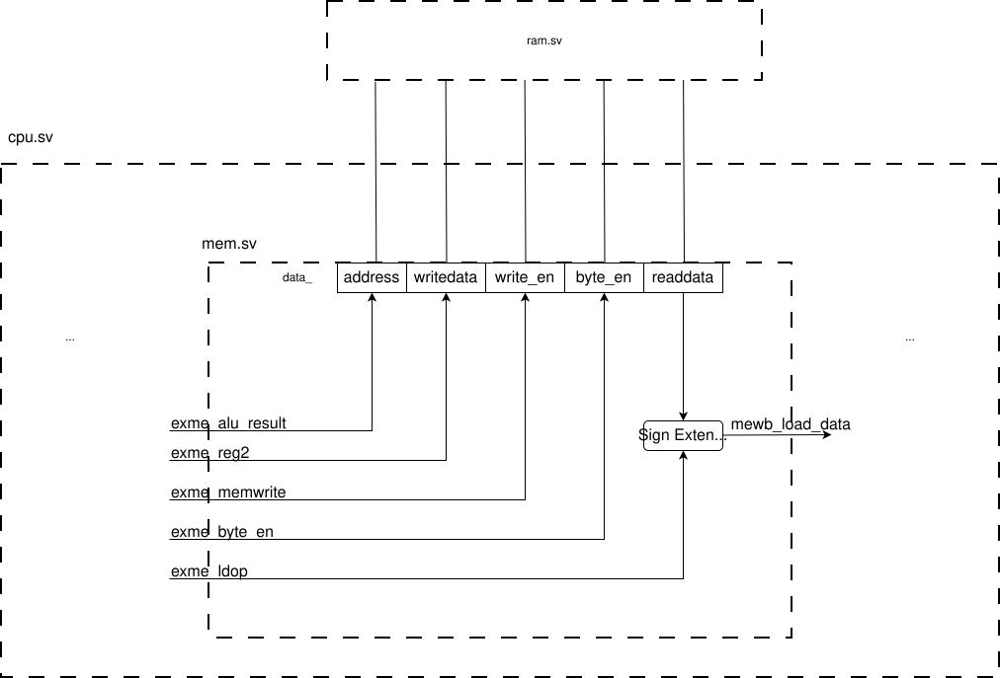
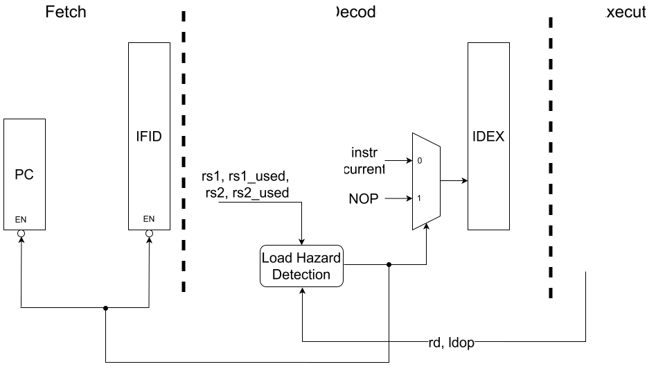

# Phase 7 - Load/Store Instructions

In this phase, you'll extend the design of your RISC-V CPU to include the load and store instructions (lw, lh, lhu, lb, lbu, sw, sh, sb).

We recommend doing this in 2 parts.  First, you'll need to support the memory instructions and not worry about hazards.  The second, add in support for hazards.

We have added ram.sv and updated cpu.sv, system.sv, and enum_defines_pkg.sv.  Copy all of your other SystemVerilog files to your phase7 repo. 


## Part 1 -- load/store instructions

To support load/store instructions, the main changes are adding a data memory to our overall system and connecting to it in the memory stage.  This is illustrated in the Figure below.  The way we organized  You can see that in mem.sv is instantiated within cpu.sv which is instantiated within system.sv (not explicitly shown).  The data memory (defined as ram.sv) is also instantiated in the provided system.sv.  We have also updated the interface of cpu.sv and wiring (to connect the memory stage, in mem.sv, to the data memory).  



The interface to the RAM has 5 signals.  In the figure above, we show them as defined in the mem.sv updated interface -- all prefixed with data\_ (the prefix isn't shown in the figure).

* data_address -- the memory address to read/write from/to.
* data_writedata -- the data to write to memory
* data_write_en -- signals whether to write the data_writedata to memory or not (set to 1 to enable the write)
* data_byte_en -- specifies which bytes to write or read, with each bit representing one byte.  Set to 0001 for a sb/lb, 0011 for sh/lh, and 1111 for sw/lw.  Other combinations aren't supported.  The data memory will mask out the bytes that are not to be written/read (e.g., if write data is 0x12345678, and you are doing a sb, only 0x78 will be written to memory)
* data_readdata -- when reading, returns the data at the memory address.  It will set leading zeroes for loads less than a word.  That means it is the responsibility of the memory stage to perform sign extention (if lb or lh).

Below we details suggested changes to each stage.

### decode.sv

In the decode stage, the key is to set the control signals for each of the load and store instructions.  This includes all of the existing ones as well as three new ones:
* memwrite -- set to 1 if this instruction writes to memory (i.e., store instructions)
* byte_en -- one-hot encoding of whether the particular byte is read/written.  Set to 0001 for byte (lb, lbu, sb), 0011 for half word, and 1111 for word.
* ldop -- Specifies what type of load operation.  There's an enum type (ldop_t) defined in enum_defines_pkg.sv, LDOP_NOT (for instructions that are not a load), LDOP_SIGNED (for lb and lh), and LDOP_UNSIGNED (for lbu and lhu). 

These all need to be defined as output ports for the decode module, and passed to the next stage.  We suggest defining as signals (e.g., s_id_ldop), and then registering in the pipeline register (e.g., putting a statement like idex_ldop <= s_id_ldop; in the always_ff block for other signals.  

Be sure to have a default for every other instruction (can put before case(opc)) so you don't have to add any code to the currently supported instructions.

NOTE: in cpu.sv you'll see the decode interface has a new output (logic s_load_hazard).  For this part, add that as an interface in decode, and just assign 0 to it.  We'll change that in part 2.


### execute.sv 

First thing needed is to pass through (from idex_<something> to exme_<something>), the three new control signals.  This includes definining new input and output ports, and registering in the pipeline register.

Next, for stores we'll need the reg2 value, so pass that through (i.e., create an output port, exme_reg2, and register the reg2 value in the pipeline register).  Note: this should be the fwdB value (i.e., pipeline as follows: exme_reg2 <= s_ex_fwdB) which is selecting the correct forwarded value to use for the instructions that use rs2.

### mem.sv

There are four main changes.

* create the new ports for connecting to memory (see the Figure above)
* create the new input ports for 3 the control signals (don't need to pass through to wb, so don't need as output ports)
* set signals to the data memory (e.g., data_address, etc.) -- they'll just be from the exme pipeline register (e.g., exme_alu_result goes to data_address).  See the Figure above.
* register value read from memory to mewb_load_data.  Note, you'll possibly need to sign extend (for lb and lh).  Take into account the ldop (exme_ldop) -- if it's signed or unsigned, and the byte_en (exme_byte_en) if it's to sign extend a byte or half word.  You can use $signed() function. Also recall the issue with slicing within an always_comb block.  See the Figure above.


### writeback.sv

* Define the new input port,  mewb_load_data 
* Update the mux that uses mewb_rfwt_sel (phase 6 only wrote to the register file the PC, when RFWT_PC, or alu result otherwise).  For Phase 7 you'll also have a potential mewb_rfwt_sel value of RFWT_LD (writing mewb_load_data to the register file).  Note enum_defines_pkg.sv provided has an updated rfwt_sel_t (to add RFWT_LD for loads).


## Part 1 Testing

We provide a test program (phase7a-provided.S) that has several test cases for loads/stores that tests these in isolation (independent of whether forwarding works, etc).  We document in the file expected results.  We will use this for grading.

So, if you ```grep "Register" out.log```, you should see all of the updates to the registers.  Compare that with the provided expected output.  If they don't match, use the waveforms to debug.


## Part 2 -- hazard detection and mitigation

In part 2 we will deal with the case where a hazard exists.  This is the case where we have load followed by any instruction that uses the register loaded into.  For example:

```
ld x1, 0(x2)
add x3, x1, x4
```
In this example, x1 will be read from memory in the mem stage but not available to be forwarded/bypassed to the execute stage until the load instruction is in the writeback stage.  Without a stall, the add instruction would be in the execute stage needing x1.

The below figure illustrates the logic we need to add.  It will include hazard detection along with mitigation (insert a nop and disable the pc and ifid pipeline register -- i.e., have them keep their current values).




### Hazard detection

Since we already defined s_load_hazard as an output port in decode in part 1, we only need to update the setting of it.  We want it to be 1 when the hazard condition is detected.  Below is some pseudocode that provides the logic to detect that condition.  It says that if the instruction in the execute stage is a load instruction (using the ldop signal in the idex pipeline register), and the instruction in the decode stage uses rs1 or rs2 and one of those is equal to the rd in the execute stage, then that's a hazard.  Note: rs1 and rs2 are determined in the decode stage, so they are signals.  And s_id_rs1_used and s_id_rs2_used are new signals that you'll need to set -- set them when you're setting all of the other control signals for each instruction (but, no need to pass this through to the next stage in the pipeline register). 

```
if (idex.ldop == LDOP_SIGNED or ex.ldop == UNSIGNED) && 
   ((idex.rd == s_id_rs1 && s_id_rs1_used) || // R, I, S, B  (not u or j types)
   (idex.rd == s_id_rs2 && s_id_rs2_used)) // // R, S, B  (not u, j, or I types)
       s_load_hazard = 1;
```

### Hazard mitigation

Now, using the s_load_hazard signal, we need to insert a nop into the idex pipeline register, and not update pc and the ifid pipeline register.

To insert a nop, we'll use the reset logic for the pipeline register, which synchronously sets the pipeline register outputs to some default value.  This is what it should currently be:
```
    always_ff @(posedge clk) begin
        if (reset || s_flush_pipeline) begin // sync reset
```
Extend the condition to if (reset || s_flush_pipeline || s_load_hazard)

To not update the pc and ifid pipeline, update the fetch stage.  Here, we're not clearing (resetting), we're just keeping the values (so, we're not enabling the register).  To do this, we need to add a condition to when the values are being updated (but not reset)

Code like below code should be in 2 always_ff blocks right now (one for updating PC, one for updating the ifid pipeline register).  This is an example of an updated condition if we only had logic to update the pc to pc+4 (leaving out branch, for simpler code here--you should not do that).  Note, in Phase 6 (and before), we had the logic to be:  if(reset condition) {set signals to 0/default} else {update values}.  Now, we'll add the condition to the else: i.e., else if (!s_load_hazard) -- such that only update if the s_load_hazard signal is 0 (meaning when it's 1, it does not get updated). 

```
        if (reset) begin
            pc <= 32'b0;
//      end else begin  // phase 6, just else
        end else if (!s_load_hazard) begin // phase 7, adding a condition
           pc <= pc+4;
        end
```

## Part 2 Testing

Here, we provide phase7b-provided.S, which tests hazard detection/mitigation (as well as ensuring you don't stall when you don't need to).  See the file for the tests run and the expected output.

So, if you ```grep "Register" out.log```, you should see all of the updates to the registers.  Compare that with the provided expected output.  If they don't match, use the waveforms to debug.


## Extra Note -- Don't need to update anything

This is for information only.  We technically needed to update the forwarding to support loads.  Previous might have had this (and equivalent for fwdB):
```
    always_comb begin
        case(s_ex_fwdA_sel)
            FWD_IDEX: s_ex_fwdA = idex_reg1;
            FWD_EXME: s_ex_fwdA = exme_alu_result;
            FWD_MEWB: s_ex_fwdA = mewb_alu_result;
            default: s_ex_fwdA = idex_reg1;
        endcase
    end 
```

For loads, we should be using wb_writedata instead of mewb_alu_result (since the ALU is used to calculate the address, so it's the mewb_load_data value).  Since wb_writedata is what we're writing to the register file, we can use that.  In cpu.sv we did this for you, where you'll see code like this:
```
//        .mewb_alu_result(mewb_alu_result),
        .mewb_alu_result(wb_writedata), // updated for Phase 7, rather than rename port, just change the signal connected to it
```

So, you do not need to update anything, but we wanted to point out this is happening.


## Complete Testing

After you complete Part 2, the testing from Part 1 (phase7a-provided.S) should still work.

We also provide a third test file, phase7c-provided.S).  This tests a special case of forwarding for store instructions.  This is needed because stores use the ALU for the address calculation, and this is what previous phases handle already (including the update noted above).  For stores, reg2 is a separate path (and new), that does need forwarding -- so, we're testing here.


## AI Use

You need to create a new file AI-use-statement.md and include a statement on how exactly you used AI (tools, prompt examples).

Note -- acceptable uses:
* Learning SystemVerilog -- e.g., provide an example of slicing in SystemVerilog.
* Code completion e.g., if I start typing something and it recognisizes a pattern, it will suggest some code to use that matches that pattern.

Note -- unacceptable uses:
* Asking it to create whole verilog code
* Proving the instructions (or code) from the assignment as asking it to complete all or part.

If in doubt, ask.  


## Submission / Grading

Add any new files you created to the git repo and commit/push all changes.  Do not include temporary files.  We include a .gitignore that should catch these, but in case it doesn't, don't add them.

Submit the URL in canvas as the submission when you are completed. 


### Rubric:

10 points total

phase7a-provided - 6pt, phase7b-provided - 3 points, phase 7c-provided - 1 point.

We will run the test cases we provide.  If you get the tests correct, you will get full credit for that part.  So, you can know correctness before submission.  We will not add hidden tests.  Note: you will immediately get a 0 for the entire Phase (not just the part) if you try to game this -- like outputting some known correct output without correctly operating code.  We can easily check for this, so don't do it. 

If you get any incorrect, we'll have opportunities for partial credit.  We'll look at the code and if you have something reasonable there, we'll give you partial credit (this is subjective, but we will have internal agreed upon guidelines for us to use but will not be explicitly sharing this).

If your System Verilog code does not compile and run without errors, you will be assigned a 0.  You will be given 24 hours to correct and notify the TA that let you know of the error, and then we will re-grade.  Related: See Announcement for Phase 3 about the version of Icarus differences.

For AI_use_statement.md -- we are no longer giving credit, but if it does not exist we will subtract 1 point.

